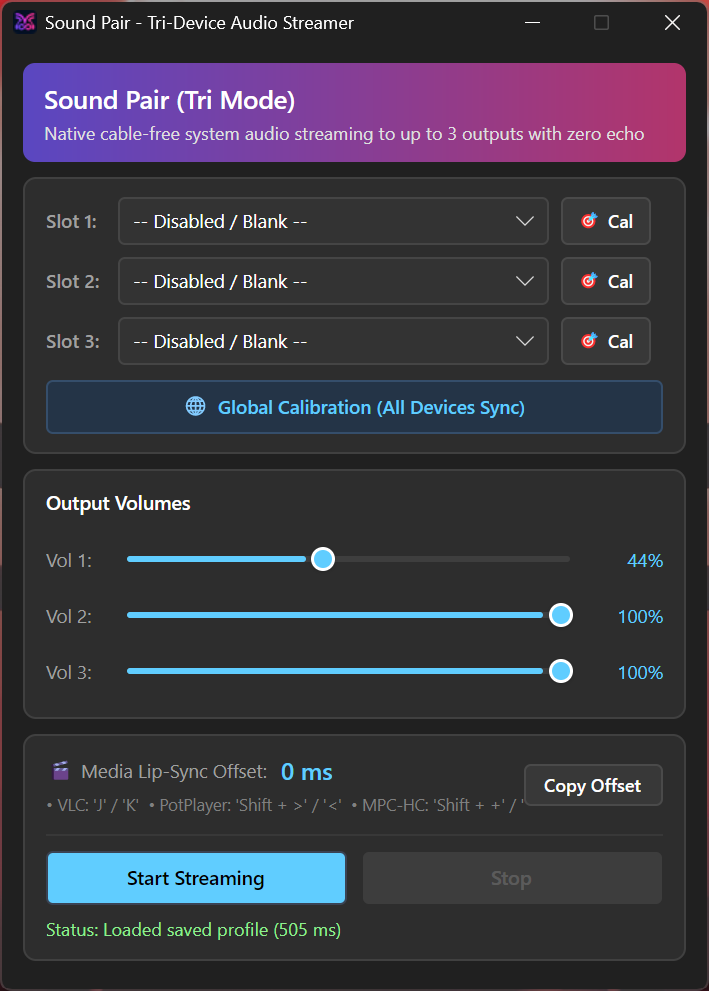
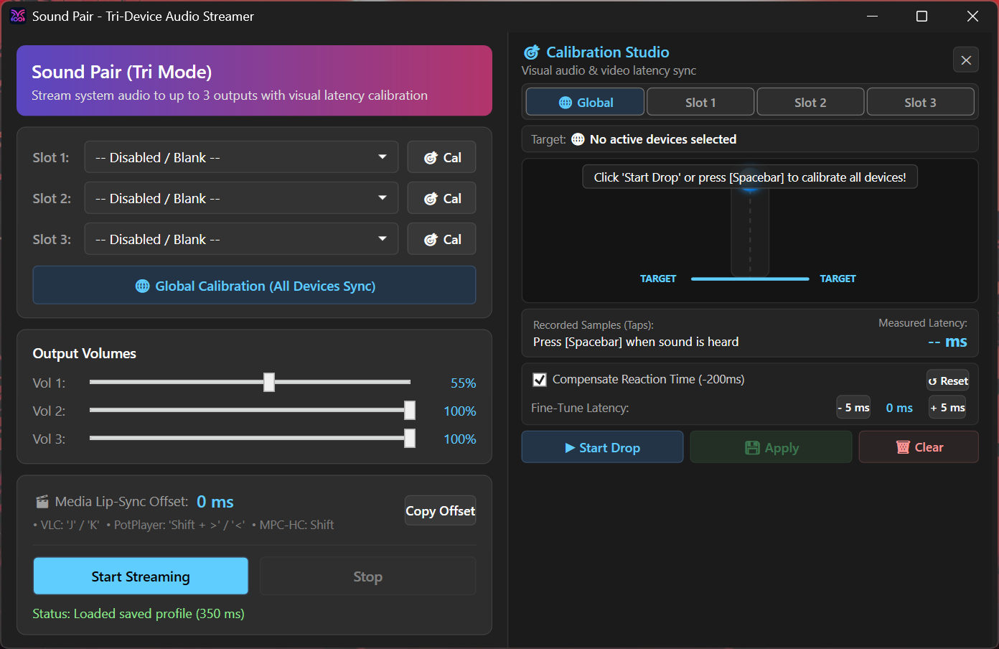

<div align="center">


# SoundPair

[](https://github.com/tousifkhan-web/SoundPair/releases)
[](LICENSE.md)

</div>

A modern, high-performance C# desktop application built with **Avalonia UI 11** designed to route audio via **Native Windows Process Loopback** (driver-free) to **up to three audio devices simultaneously** with millisecond-precision delay synchronization, independent volume controls, visual calibration, and real-time Windows master volume linking.

---

## 📥 Download

Download the latest standalone release for Windows:

<div align="center">

[](https://github.com/tousifkhan-web/SoundPair/releases/latest/download/SoundPair.exe)

<br/>

**[📦 SoundPair.exe](https://github.com/tousifkhan-web/SoundPair/releases/latest/download/SoundPair.exe)**  
_Single self-contained `.exe` • Windows 10 / 11 (64-bit) • No installation or .NET runtime required_

You can also view all releases and changelogs on the **[Releases Page](https://github.com/tousifkhan-web/SoundPair/releases)**.

</div>

---

## 📷 App Preview

 

---

## 🚀 Setup & Quick Start Guide

Follow these simple steps to get SoundPair up and running from scratch:

### Step 1: Zero Driver Setup (Driver-Free)

SoundPair utilizes **Native Windows 11 Process Loopback Capture** (`WithProcessLoopback`).

- **No virtual audio cables, third-party drivers, or kernel drivers are required.**
- Captures pre-mute system audio directly across all apps with zero configuration.

### Step 2: Automatic Speaker Echo Cancellation

When streaming starts, SoundPair automatically silences your internal PC speakers to prevent local room echo while preserving full system audio loopback to your connected headphones and speakers. When you stop streaming or exit the app, your speaker's original state is seamlessly restored.

### Step 3: Connect & Select Your Audio Devices

1. Turn on and connect your audio outputs (Bluetooth headsets, wired headphones, speakers, or USB DACs).
2. SoundPair features dynamic hardware detection and will automatically populate your connected outputs in the dropdown menus:
   - **Device Slot 1 (Primary)**
   - **Device Slot 2 (Optional / Adjustable)**
   - **Device Slot 3 (Optional / Adjustable)**
3. Choose the audio devices you want to stream to (supports up to **3 wireless Bluetooth audio devices** simultaneously with zero connection limits).

### Step 4: Dual-Pairing (Multipoint) Call Pause & Zero-Drift Resume

- **Dedicated Per-Slot Pause Buttons (`⏸` / `▶`):** Next to each device dropdown, a dedicated hardware pause button allows you to instantly halt streaming to that specific headset without affecting the other connected outputs.
- **Bluetooth Radio Airtime Protection:** When a dual-pairing headset switches to your phone for an incoming call, clicking **Pause** halts WASAPI frame generation and clears its buffer. This immediately stops Windows from sending unacknowledged Bluetooth packets, preventing radio contention and ensuring the other active headset continues playing smoothly with **zero sound breaks, stuttering, or pauses**.
- **Zero-Drift Resume Guarantee:** When your phone call ends, clicking **▶ Resume** flushes any stale audio and pre-fills the exact calibrated silence padding, resuming playback in instantaneous, perfect sync with your other outputs and video.

### Step 5: Calibrate & Fine-Tune Audio Delays

- **Visual Calibration Studio (Ball Drop & Spacebar Sync):** Click **🌐 Global Calibration** below the device slots to open the visual calibration drawer. Put on your headset, watch the ball drop down the chute, and tap the **[Spacebar]** the instant you hear the audio click. SoundPair averages your tap responses, compensates for human reaction time, and automatically balances delay offsets across all active outputs.
- **Individual Slot Calibration Tabs:** Inside the drawer, easily switch between **🌐 Global**, **Slot 1**, **Slot 2**, and **Slot 3** tabs to fine-tune individual device offsets.
- **Persistent Device Profiles:** Calibrated delays are automatically saved to `device_profiles.json`. When you reconnect or select the same device in the future, SoundPair instantly recalls your calibration profile.
- **Manual Delay Controls:** Use the `- 10 ms`, `+ 10 ms`, or direct numeric input box for each slot to manually nudge or fine-tune synchronization with zero slider limit constraints. Click the `↺ 0` button to instantly reset any slot back to 0 ms.
- **Desktop Media Player Lip-Sync Auto-Sync:** When balancing outputs requires buffering, SoundPair calculates the exact audio-to-video delay compensation. Click **⚡ Sync Player** inside Global Calibration (or let SoundPair auto-sync automatically in the background) to inject the exact negative delay into active players (**PotPlayer**, **VLC**, **MPC-HC**, and **MPV**).
- **Web Browser Video Sync (YouTube / Netflix / Prime Video):** Install the official companion extension (**SoundPair**) in Chrome, Edge, Brave, or Firefox (available on Mozilla Add-ons). It connects to SoundPair's built-in local sync server (`http://127.0.0.1:48888`) and delays HTML5 video playback to match your Bluetooth headphones' physical latency in real-time.
- **Independent Volume Controls:** Adjust the dedicated volume sliders (0–100%) for each slot independently, or let them synchronize in real-time with your Windows master volume mixer and keyboard media keys.

### Step 6: Start Streaming

Click the **Start Streaming** button. SoundPair executes a fast Bluetooth radio warmup handshake to wake up all wireless radios, establishes low-latency WASAPI loopback streams, and routes audio to all selected devices in perfect synchronization!

---

## ✨ Key Features

- **Tri-Device & Tri-Wireless Simultaneous Streaming:** Route Windows audio to up to 3 separate playback outputs simultaneously—supporting up to 3 wireless Bluetooth headsets or speakers with independent lock-free buffer underrun protection.
- **Dual-Pairing (Multipoint) Call Pause & Resume:** Dedicated `⏸` / `▶` icon buttons per slot that instantly stop transmission to a headset during a phone call, freeing 100% of the PC's Bluetooth radio airtime to prevent breaking or stuttering on other headsets.
- **Zero-Drift Synchronization Guarantee:** Automatic buffer clearing and precision silence padding injection ensures resumed streams align instantaneously with active playback without any accumulated latency drift.
- **Dynamic Mixed-Format Audio Engine (Zero Quality Loss):** Internal 32-bit IEEE Floating-Point master pipeline with studio-grade **Cockos WDL Resampling** (< -120 dB THD+N). Simultaneously drives mixed formats (e.g., 16-bit 44.1 kHz, 24-bit 96 kHz, and 32-bit audio) with full dynamic range and zero phase distortion.
- **Isolated Backlog Buffering (RF Jitter Protection):** Dynamic 800 ms backlog ceiling per slot isolates struggling or distant wireless headsets, ensuring Bluetooth packet drops on one device never cause audio stutter on others.
- **Automated Desktop Media Player Lip-Sync:** Background process detection and automated video delay injection for **PotPlayer**, **VLC**, **MPC-HC**, and **MPV**.
- **Official SoundPair Browser Extension:** Real-time HTML5 video delay synchronization for YouTube, Netflix, Prime Video, Disney+, Twitch, and any web video player.
- **Zero Drivers Required:** Native Windows 11 Process Loopback captures clean audio with zero extra software or virtual cables installed.
- **Interactive Visual Calibration Studio:** Visual ball-drop animation with synchronized audio pulses and spacebar reaction timing. Eliminates unreliable microphone acoustic chirps and room noise interference.
- **Persistent Device Profiles:** Automatically saves device latency profiles (`device_profiles.json`) and auto-loads balanced delay configurations whenever recognized devices are selected.
- **Auto-Balanced Multi-Device Delay:** Intelligently identifies the slowest audio device, computes the required buffer padding for faster devices, and adjusts delay sliders automatically.
- **Manual Millisecond Delay Controls:** Stepper buttons (`- 10 ms`, `+ 10 ms`, `↺ 0`) and direct numeric millisecond input per slot to eliminate echo or drift between disparate hardware models without artificial range restrictions.
- **Independent & Synchronized Volume Controls:** Dedicated volume percentage sliders for Device Slots 1, 2, and 3, linked bidirectionally with Windows endpoint volume notifications in real-time.
- **Dynamic Hardware Detection:** Actively listens for Windows device arrival and removal events (`WM_DEVICECHANGE`) to refresh device lists dynamically without requiring an app restart.
- **Bluetooth Cold-Start Warmup:** Runs a hardware handshake prior to streaming to wake up dormant Bluetooth radios, eliminating first-launch desync and buffer underruns.
- **Minimize to System Tray:** Seamlessly minimizes to the Windows notification tray area with a right-click context menu (Open / Exit) to keep your workspace clutter-free.
- **Single-Instance Enforcement:** Uses a system-wide named Mutex to ensure only one streaming instance runs at a time, preventing port and endpoint locks.
- **Modern Glassmorphic Dark UI:** Windows 11 Fluent Dark aesthetic with custom circular slider thumbs, card containers, smooth side drawer animations, and native dark title bar support (`DwmSetWindowAttribute`).

---

## 🛠️ Tech Stack & Requirements

- **Language:** C# 12 / .NET 10 (Windows-specific platform support)
- **UI Framework:** Avalonia UI 11 (High-Performance, Lightweight Desktop UI)
- **Audio Architecture:** NAudio 3.1.0 (WASAPI Process Loopback Capture & Low-Latency WasapiPlayer)
- **OS:** Windows 10 / Windows 11 (64-bit)

---

## 📦 How to Build and Publish

SoundPair includes a convenient build script (`build.bat`) in the project root that creates a standalone, self-contained single-file executable:

```cmd
build.bat
```

Or you can build via the .NET CLI:

### Standalone Build (Self-Contained Single-File)

Bundles the complete .NET 10 runtime, native dependencies, and compression into a single self-extracting executable (`publish/SoundPair.exe`). Does not require any pre-installed .NET runtimes on target machines:

```bash
dotnet publish SoundPair.csproj -c Release -r win-x64 --self-contained true -p:PublishSingleFile=true -p:AssemblyName=SoundPair -o ./publish -p:IncludeNativeLibrariesForSelfExtract=true -p:EnableCompressionInSingleFile=true
```

---

## 📜 License

This project is licensed under the **PolyForm Noncommercial License 1.0.0**.

- Free for personal use, research, hobby, education, and noncommercial organizations.
- Commercial use, resale, or distribution requires explicit permission or a separate commercial agreement from the author.

See [LICENSE.md](LICENSE.md) for full license terms and conditions.

### Third-Party Libraries

- [Avalonia UI](https://github.com/AvaloniaUI/Avalonia) - Licensed under the [MIT License](https://github.com/AvaloniaUI/Avalonia/blob/master/licence.md)
- [NAudio](https://github.com/naudio/NAudio) - Licensed under the [MIT License](https://github.com/naudio/NAudio/blob/master/license.txt)
